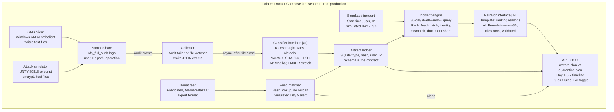

# Dwell-Window Threat Assurance — POC Implementation Plan (Draft v0.2, hackathon edition)

*Draft for DEV team review*

## Contents

1. [Purpose and status](#purpose-and-status)
2. [Problem and POC goal](#problem-and-poc-goal)
3. [Why today's antivirus doesn't close this gap](#why-todays-antivirus-doesnt-close-this-gap)
4. [Guiding principles](#guiding-principles)
5. [Architecture overview](#architecture-overview)
6. [Tech stack and repository layout](#tech-stack-and-repository-layout)
7. [Step-by-step implementation: the 48-hour build](#step-by-step-implementation-the-48-hour-build)
8. [How we build: spec-driven with Claude Opus 5.5](#how-we-build-spec-driven-with-claude-opus-55)
9. [Team and roles](#team-and-roles)
10. [Evaluation and definition of done](#evaluation-and-definition-of-done)
11. [Risks and mitigations](#risks-and-mitigations)
12. [Open decisions for the DEV team](#open-decisions-for-the-dev-team)
13. [Sources](#sources)

---

## Purpose and status

We will build a standalone Dwell-Window Threat Assurance (DwTA) proof of concept as a hackathon project: a rules-only core that always works, plus AI layers behind the same interfaces. This draft walks the DEV team through how, step by step, so we can challenge and refine it before the build starts.

- **Audience:** DEV, security, QA and PM reviewers.
- **Status:** draft v0.2, rescoped to fit the hackathon. Comment on any line; the decisions still open are listed near the end.
- **Out of scope:** any change to production Edge, NMC or Ransomware Protection code. The POC runs in its own lab.

## Problem and POC goal

Today a file an attacker plants on a share and leaves alone is never flagged, and Targeted Restore leaves it in place after recovery. Detection is behavior-based, and antivirus checks a file once at write time with that day's signatures.

The POC proves we can close that gap cheaply: recognize risky files by content at write time, remember them in a small ledger, re-check them by hash lookup when threat intelligence catches up, and list them next to the restore plan when an incident fires.

**The 5-minute demo story**

1. **Simulated Day 1:** an attacker identity copies `Q3-Report.pdf` (really a harmless test executable) to the Finance share. Today's antivirus calls it clean because nothing knows it yet. The POC classifies it by content, flags the extension mismatch, hashes it and alerts.
2. **Simulated Day 5:** a threat feed publishes that file's hash. The matcher finds it in the ledger with a lookup, not a rescan, and raises a critical alert.
3. **Simulated Day 7:** an encryption run triggers an incident. The UI shows the restore plan and, beside it, a ranked quarantine plan of what the attacker left in the dwell window.
4. **Toggle:** the same scenario shown as "rules only" and "rules + AI", so the audience sees exactly what AI adds.

The lab runs on a simulated clock. Events carry backdated timestamps, so the whole week-long attack replays in a few minutes on stage.

## Why today's antivirus doesn't close this gap

Nasuni's Antivirus Protection is a sound write-time gate, but it judges each file once, against the signatures known at that moment. DwTA adds the second look that a dwell-window attack exploits, so it complements the antivirus feature rather than replacing it.

**What the product does today, per Nasuni's documentation**

- Antivirus Protection uses the open-source ClamAV engine and scans every new or modified file before it is protected in cloud storage ([Antivirus Protection](https://docs.nasuni.com/docs/nasuni-antivirus-protection)).
- Scans run in batches at snapshot time, or on file close when "Check files immediately" is enabled on an SMB volume. Definitions sync within four hours of a ClamAV update ([NMC Task Overview](https://docs.nasuni.com/docs/nmc-task-overview)).
- It does not detect malware in encrypted or password-protected files, files over 25 MB, or large container files ([NMC Cyber Resilience page](https://docs.nasuni.com/docs/nmc-cyber-resilience-page)).
- An infected file stays in the Edge cache, unprotected, until an administrator ignores or deletes it ([Antivirus Protection](https://docs.nasuni.com/docs/nasuni-antivirus-protection)).
- Ransomware Protection flags known ransomware file extensions and ransom notes as they appear, and notifies administrators ([Nasuni Ransomware Protection](https://docs.nasuni.com/docs/nasuni-ransomware-protection)).

The docs describe scanning new or modified files only; we found no retroactive rescan of unchanged files. They also note that a full scan with a third-party scanner would pull all data into the Edge cache, which is why DwTA re-checks by hash lookup instead. The team should confirm both points with the Edge antivirus owners.

| Question | Antivirus Protection today | Ransomware Protection today | What DwTA adds |
|---|---|---|---|
| When is a file checked? | Once, when new or modified | When files are created or renamed | At write, then again by hash lookup each time new threat intelligence arrives |
| Checked against what? | ClamAV signatures known at scan time | Known ransomware extensions and ransom notes | Content type plus context: who wrote it, from which IP, onto which share |
| A new payload with no signature yet | Passes as clean and goes to cloud storage | Not in scope | Recorded in the ledger; flagged if it is executable content on a document share |
| A binary renamed `.pdf` | Passes unless a signature matches | Not in scope | Flagged by the content-type mismatch |
| Files antivirus can't inspect (encrypted, over 25 MB) | Not checked for malware | Not in scope | Hash and writer still recorded, so a later feed match still lands |
| After an incident | No link to the attack's dwell window | Alerts; Targeted Restore recovers encrypted files but leaves planted files in place | A ranked quarantine list of what the attacker planted, beside the restore plan |
| Remediation | Ignore or delete | Not applicable | Proposed quarantine: move to a locked folder after admin approval, never delete |

In the demo, a ClamAV container scans the planted file on simulated Day 1 and reports it clean. That is the honest baseline: the gap is about timing and context, not a weak engine.

## Guiding principles

Six rules shape every design choice below; if a step breaks one, we change the step.

1. **Isolated.** The POC only consumes an SMB share in its own Docker lab. Its one contract with the product is the event and ledger schema, so it can later feed or be replaced by Edge code without a rewrite.
2. **Rules first, AI optional.** The deterministic path (magic bytes, SHA-256, lookup, ranking rules) is the source of truth and always works on its own. AI adds signals and explanations behind the same interfaces, never replaces the core.
3. **Never in the write path.** Classification runs asynchronously after file close. Nothing blocks or slows a user's write.
4. **Spec-driven.** Specs and contract tests come before code. Claude Opus 5.5 generates code against them; humans own the specs and review every merge.
5. **Safe by construction.** No real malware, ever. Only EICAR, benign test binaries and a harmless macro document. The threat feed is fabricated, and the LLM can read evidence but never act.
6. **Cut, don't stretch.** Anything not working at a gate is cut, not extended. The rules-only path is protected first, and stretch items start only after the full demo works.

## Architecture overview

Every file written to the lab share flows through one asynchronous pipeline into a small ledger; AI plugs in behind two interfaces, the classifier and the narrator.

**Diagram: One async pipeline; AI plugs in behind two interfaces** (all components run inside an isolated Docker Compose lab, separate from production; components marked **[AI]** have an AI implementation, but the rules version always works on its own)



The classifier writes each ledger record and the feed matcher marks matches on it; the incident engine and UI only read it.

**The integration contract.** The event record below and the ledger schema are the only parts the product would need to adopt later; everything else in the POC is replaceable.

```json
{
  "ts": "2026-11-02T09:14:07Z",
  "volume": "finance",
  "path": "/Q3/Q3-Report.pdf",
  "user": "jdoe@corp",
  "client_ip": "10.0.0.15",
  "type_class": "pe_binary",
  "classifier": "rules",
  "ext_mismatch": true,
  "sha256": "...",
  "tlsh": "...",
  "size": 245760
}
```

## Tech stack and repository layout

Everything is open source, runs in one Docker Compose project, and needs no network access during the demo; items marked stretch start only after the full demo works.

| Layer | Rules core (must-have) | AI layer (should-have) |
|---|---|---|
| SMB share and audit | Samba container with `vfs_full_audit` (user, IP, path, operation) | No change |
| Event capture | Audit-log tailer, with a Python file watcher as fallback | No change |
| Antivirus baseline | ClamAV container with pre-pulled definitions, to show today's verdict | No change |
| File typing | Magic-byte signature table and structural checks, extension-mismatch rule | Magika as primary, magic bytes as fallback |
| Document and script checks | oletools (macros), YARA-X rules (LNK, scripts, PE) | Stretch: LLM explanation of extracted macro code |
| Hashing | SHA-256; stretch: TLSH for variant similarity | No change |
| Unknown-binary risk | Stretch: entropy and `pefile` heuristics | Stretch: EMBER2024 LightGBM risk score |
| Threat feed | Fabricated local feed in MalwareBazaar export format | No change |
| Ledger and API | SQLite, FastAPI, simulated clock | No change |
| Quarantine narrative | Jinja2 template of ranking reasons | Foundation-sec-8B via Ollama, with citation validator and template fallback |
| UI | One static page: restore plan vs. quarantine plan | Adds the rules / rules + AI toggle |
| Attack simulation | Existing safe simulator (UNTY-89818) or a Ransomwhere-style script | No change |

```
dwta-poc/
  SPEC.md              # product spec, demo story, acceptance scenarios
  CLAUDE.md            # coding conventions and rules for Claude Opus 5.5
  specs/               # schemas, OpenAPI, ranking rules, prompts
  lab/                 # docker-compose, smb.conf, ClamAV baseline, test artifacts
  services/
    collector/         # audit-log tailer and file watcher
    classifier/        # Classifier interface: rules, Magika
    ledger/            # SQLite schema, repository, simulated clock
    matcher/           # feed ingest and retroactive lookup
    incident/          # dwell-window query and ranking
    narrator/          # Narrator interface: template, LLM
    api/               # FastAPI
  ui/                  # static page
  eval/                # corpus, harness, results
  tests/               # contract and acceptance tests
```

## Step-by-step implementation: the 48-hour build

The whole build fits in 48 hours with four people working in parallel lanes. The rules-only core is protected first, and each block ends with a gate that must pass before the next block starts.

**Diagram: The rules-only core must run by H24; the full demo by H36** (four lanes in parallel, hours from the start of the hackathon; the AI engineer's lane is should-have)

| Lane | H0-H3 | H3-H12 | H12-H24 | H24-H36 | H36-H44 | H44-H48 |
|---|---|---|---|---|---|---|
| Whole team | Spec pack | | | | Rehearse | Submit |
| Security eng. | | Lab + collector | Rules + ranking | FP + overhead runs | | |
| Backend eng. | | Ledger + API | Matcher + incident | Demo UI | | |
| AI engineer (should-have) | | Ollama + Magika | Narrator + validator | AI toggle + cache | | |
| PM / QA | | Corpus + clock | Acceptance runs | Measurements | | |

Gates: **Gate 1** at H12, **Gate 2 (go/no-go)** at H24, **Gate 3** at H36.

Gate 2 at H24 is the go/no-go: if the rules-only scenario does not run end to end by then, the AI engineer joins the core lane and we drop the LLM, keeping only Magika.

### Step 0. Before the clock starts

- Confirm what the hackathon rules allow as prep. This plan assumes environment setup is allowed and product code is not.
- InfoSec approves the safe-artifact list: EICAR, benign test binaries, a harmless macro document, a shortcut file.
- Pull Docker images, ClamAV definitions, Magika and the LLM weights in advance, so nothing downloads during the build.
- **Done when:** a client can mount the lab share with the network unplugged.

### Step 1. H0-H3: Spec pack (whole team)

- Event and ledger schemas, classification taxonomy, ranking rules with weights, OpenAPI contract, prompt and output schema, `CLAUDE.md`.
- Acceptance scenarios for simulated Days 1, 5 and 7.
- **Done when:** the acceptance tests exist and fail, and the lead signs off.

### Step 2. H3-H12: Walking skeleton (four lanes in parallel)

- Security: Samba `vfs_full_audit` and the collector, including temp-file-then-rename writes.
- Backend: SQLite ledger, API skeleton, command-line runner, simulated clock.
- **[AI]** AI: Ollama serving the LLM; Magika wrapper behind the `Classifier` interface.
- PM/QA: test corpus, scenario script, first draft of the demo script.
- **Gate 1 (H12):** simulated Day 1 runs end to end from the command line: copy, event, classification, ledger row, alert.

### Step 3. H12-H24: Core features

- Security: full rules classifier (magic bytes, structural checks, oletools, YARA-X) and ranking weights.
- Backend: idempotent feed matcher, incident engine with dwell-window query and ranking, template narrative, quarantine move after admin approval.
- **[AI]** AI: narrator with citation validator and template fallback.
- PM/QA: acceptance runs after every merge.
- **Gate 2 (H24, go/no-go):** the rules-only scenario for simulated Days 1, 5 and 7 runs end to end through the API.

### Step 4. H24-H36: Demo UI and AI integration

- Backend: one static page with the restore plan, quarantine plan, scenario strip and toggle.
- **[AI]** AI: Magika as primary classifier, narratives precomputed when the incident fires, the rules / rules + AI toggle.
- Security: ClamAV baseline on the planted file, false-positive runs on a document share vs. a software share, overhead on a 1,000-file copy.
- PM/QA: write up the measurements and set up the backup recording.
- **Gate 3 (H36):** both modes run live from a cold start.

### Step 5. H36-H44: Freeze and rehearse (whole team)

- Fix only demo-blocking bugs. Code freeze at H40, then three full rehearsals and a backup recording.

### Step 6. H44-H48: Buffer and submission

- Final rehearsal, slides and submission.

**Rest:** each person takes one block of about 5 hours off between H16 and H34, staggered so no two lanes stop at once.

**Stretch, only after Gate 3:** EMBER2024 risk score, TLSH variant matching, entropy and `pefile` heuristics, macro explainer, analyst Q&A agent.

## How we build: spec-driven with Claude Opus 5.5

Humans write the specs and review every merge; Claude Opus 5.5 writes the code, tests, Docker files and docs against those specs. Each lane runs its own Opus session against the shared spec pack, and the contract tests written in the spec block are what keep four parallel sessions compatible.

**The loop, per module**

1. Write or update the module's spec: purpose, inputs and outputs, edge cases, acceptance tests.
2. Ask Opus for the contract tests first, then the implementation.
3. Run the tests locally and in CI.
4. A human reviews the diff against the spec, not just the test results.
5. If the behavior must change, change the spec and regenerate. Never patch around the spec.

**Repo conventions that keep sessions consistent**

- `SPEC.md` and `specs/` are the single source of truth. Every Opus session starts by reading them.
- `CLAUDE.md` fixes language versions, style, logging, error handling, and the rule that no code may block the write path.
- Modules stay small and talk only through the schemas, so one can be regenerated without touching the others.
- Each lane merges to main at least every 3 hours, and CI runs the contract tests on every merge, so integration problems surface early.

**Where Opus helps, and where a human must decide**

| Opus does well | A human owns |
|---|---|
| Parsers, schemas, contract tests | Samba and lab setup, real SMB client behavior |
| Matcher, ranking code, report template | Ranking weights and false-positive tuning |
| FastAPI, static UI, Docker Compose | What the demo can honestly claim |
| Model wrappers, evaluation harness, output validator | Judging whether AI output is security-correct, model licenses |

## Team and roles

Four people cover the hackathon, one per lane; the AI engineer's lane is the one we cut first if the core falls behind.

| Role | Owns | Steps | Skills |
|---|---|---|---|
| Security / file-share engineer (spec owner) | Spec pack lead, Samba lab, collector, rules classifier, ranking rules, ClamAV baseline, false-positive runs | 0-4 | Samba audit, file formats, dwell-time tradecraft, safe lab handling |
| Backend / Python engineer | Ledger, simulated clock, API, matcher, incident engine, demo UI, CI | 1-5 | Python, SQLite, FastAPI, Docker, critical review of generated code |
| ML / AI engineer | Ollama serving, Magika, narrator, citation validator, toggle | 1-4 | Model serving (Ollama or vLLM), evaluation design, output schemas, guardrails |
| PM / QA | Prep and approvals, test corpus, acceptance runs, measurements, demo script, backup recording | 0-6 | Test design, stakeholder and InfoSec liaison, demo storytelling |

With only three people, the backend engineer absorbs the acceptance runs, and the AI scope shrinks to Magika plus the template narrative.

## Evaluation and definition of done

The POC is done when both modes run live from a cold start and every check below is measured; the target values are proposals for the team to agree in the spec block.

| Check | Applies to | How we measure | Proposed target |
|---|---|---|---|
| Demo scenario, simulated Days 1, 5, 7 | Both | Acceptance tests, live run | Passes from a cold start |
| Antivirus baseline | Both | ClamAV scan of the planted file | Reports clean, showing the gap honestly |
| Write-path overhead | Both | 1,000-file copy with and without the collector | No user-visible slowdown; number recorded |
| False positives | Both | Alerts on a benign document share vs. a software share | Counts recorded; document share near zero |
| Disguised-file detection | Both | Corpus of renamed files | Rules catch every corpus case; Magika equal or better |
| Narrative citations | AI | Validator on 2 golden incidents | 100% of claims cite a ledger row |
| Narrative accuracy | AI | Human review of the 2 golden incidents | Zero factual errors |
| Fallback | AI | Stop the LLM mid-demo | Template narrative appears, demo continues |

Deliverables: the running lab, the repo, a one-page results sheet, a 5-minute demo script and a backup recording.

## Risks and mitigations

The two risks most likely to break a 48-hour build are SMB event timing and running out of time; both have a fallback that keeps the demo intact.

| Risk | Impact | Mitigation |
|---|---|---|
| SMB clients write temp files and rename them, so close events land on the wrong path | Missed or duplicate ledger rows | Collector follows renames; switch to the Python file watcher if audit parsing is not reliable by Gate 1 |
| 48 hours is not enough for everything | Unfinished demo | Must/should/stretch fixed in the spec block; the rules-only path is protected first; drop the LLM at Gate 2 if needed |
| Downloads or installs fail on the day | Lost hours | Pull images, ClamAV definitions, Magika and LLM weights before the clock starts; run the lab offline |
| LLM states something the evidence does not support | Loss of trust in the demo | Citation validator, template fallback, and the validator shown rejecting a bad output |
| No GPU or Apple Silicon machine for the LLM | Slow or missing narrative | Book hardware during prep; precompute narratives when the incident fires |
| Four parallel Opus sessions drift apart | Modules that don't fit together | Contract tests from the spec block, merges every 3 hours, CI on every merge |
| Generated detection logic looks right but isn't | False confidence | Every rule is run against the corpus and the result recorded |
| Model and feed licenses block later productization | Rework before product integration | Legal checks Foundation-sec (built on Llama 3.1), EMBER2024 and abuse.ch terms after the hackathon, before any product work |
| "Is this AI theater?" | Weak reception | The rules / rules + AI toggle, the ClamAV baseline and the measured results answer it |

## Open decisions for the DEV team

These decisions need an answer before the build starts or during the spec block; tick each one off as we agree it, and comment with your view.

- [ ] **Hackathon rules:** what prep is allowed before the clock starts (images, models, lab VM, an empty repo skeleton)?
- [ ] **Demo audience:** hackathon judges, engineering leadership or a customer advisory group? This sets how polished the UI must be.
- [ ] **Owners:** names for the four lanes.
- [ ] **Antivirus behavior:** can the Edge antivirus owners confirm there is no retroactive rescan of unchanged files?
- [ ] **Primary event source:** Samba audit-log tailer, or the Python file watcher from the start?
- [ ] **Quarantine mechanics:** move to a locked folder, or lock down in place with a deny-all ACL?
- [ ] **Dwell-window default:** 30 days, or shorter for the demo story?
- [ ] **Ranking weights:** who signs off on them, security or PM?
- [ ] **LLM choice:** Foundation-sec-8B Instruct, Foundation-sec-8B Reasoning, or a general model such as Qwen2.5-7B?
- [ ] **Feed realism:** fabricated feed only, or also ingest a real MalwareBazaar hash export (hashes only, never samples)?
- [ ] **Attack simulator:** reuse UNTY-89818, or a standalone script?
- [ ] **LLM hardware:** which GPU or Apple Silicon machine, and who books it?

## Sources

- [Antivirus Protection](https://docs.nasuni.com/docs/nasuni-antivirus-protection), Nasuni documentation
- [NMC Cyber Resilience page](https://docs.nasuni.com/docs/nmc-cyber-resilience-page), Nasuni documentation
- [NMC Task Overview](https://docs.nasuni.com/docs/nmc-task-overview), Nasuni documentation
- [Nasuni Ransomware Protection](https://docs.nasuni.com/docs/nasuni-ransomware-protection), Nasuni documentation
- [Security, Chapter 5](https://docs.nasuni.com/docs/chapter-5-security), Nasuni documentation
