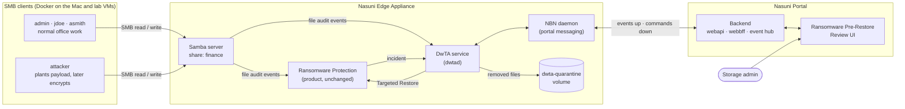
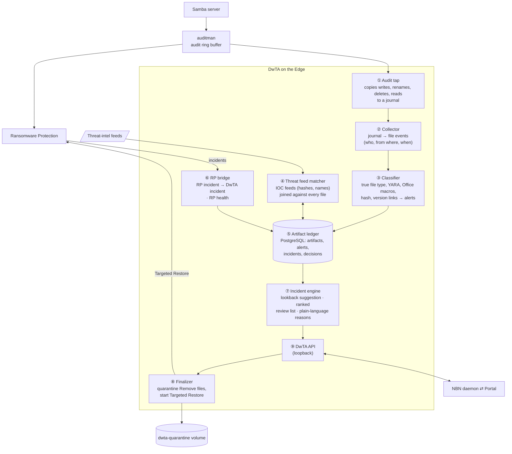
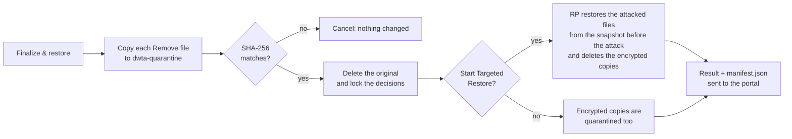

# DwTA: What We Built

Dwell-Window Threat Assurance (DwTA) for the Nasuni Edge Appliance, built during the hackathon.

## 1. The problem

Ransomware attackers usually get in days before they encrypt anything. During that dwell window they plant a payload,
often a program disguised as a document, on a share. Today's defences each miss part of the story:

- Antivirus checks a file once, when it is written, and at that moment nothing knows the file is bad.
- Ransomware Protection (RP) on the Edge detects the encryption burst, not the plant that came before it.
- Targeted Restore rolls the encrypted files back to the last snapshot before the attack, but the planted payload stays
  on the share, ready for the next attack.

DwTA closes that gap. It records every file written to the Edge with its content facts and its context, keeps checking
the past as threat intelligence catches up, and, **before a restore**, gives the admin a ranked, explained list of
suspicious files written since a chosen lookback start. The admin marks each one **Remove** or **Keep**. Remove files
go to a quarantine volume, then RP's Targeted Restore brings back the encrypted files.

## 2. What we delivered

- **DwTA on the Edge.** A new service (`dwtad`) and a small audit tap running on a real Nasuni Edge Appliance. It records
  and classifies every write, matches threat feeds, picks up RP incidents, suggests a lookback start, builds the review
  list, and finalizes: quarantine, then Targeted Restore.
- **Ransomware Pre-Restore Review in the Nasuni Portal.** A new section under Appliance Services where the admin sees each
  appliance's RP health and incidents, chooses how far back to review, decides Keep or Remove per file, and finalizes.
- **An end-to-end product path.** A new message contract between the portal and the Edge, carried by the existing NBN
  daemon channel, with new portal backend routes, event processors and database tables.
- **A realistic lab.** Active Directory accounts, SMB clients on separate machines, and a simulator that replays a week of
  office work, a quiet plant, a threat-intel update and an encryption attack that the real RP detects.

## 3. The big picture



RP itself is unchanged. DwTA reads the same audit stream RP uses, takes RP's incidents as its trigger, and hands the
final restore back to RP.

## 4. Inside the Edge Appliance

Every DwTA block reads the audit stream RP already uses. None of them block a write. Only the classifier reads file
contents, within a fixed read budget.



| # | Block | What it does |
|---|---|---|
| ① | Audit tap | Copies each file operation from the audit buffer RP already uses into a DwTA journal. It never touches the write path. |
| ② | Collector | Turns journal lines into file events: user, client IP, computer, path and time. Reads are coalesced per file and user. |
| ③ | Classifier | Reads each new file within a budget: real type (Magika and signatures), YARA, Office macros, SHA-256. Links new versions to old ones and raises alerts, for example a program disguised as a PDF. |
| ④ | Threat feed matcher | Loads IOC feeds and matches them against everything ever written, so a file planted days ago is flagged the moment a feed lists it. |
| ⑤ | Artifact ledger | DwTA's memory: every file version, its alerts, the incidents and the admin's decisions. |
| ⑥ | RP bridge | Picks up each new RP incident, creates the matching DwTA incident, and reports RP health per volume every 5 minutes. |
| ⑦ | Incident engine | Suggests a lookback start, then builds the ranked review list with plain-language reasons, file history and volume activity. |
| ⑧ | Finalizer | Moves Remove files to the quarantine volume (copy, verify SHA-256, then delete the original) and starts RP's Targeted Restore. |
| ⑨ | DwTA API | The single entry point from the portal into DwTA, reached through the NBN daemon and the Edge's router. |

## 5. End-to-end flow

```mermaid
sequenceDiagram
    autonumber
    actor A as Attacker (SMB client)
    participant S as Samba + RP on the Edge
    participant D as DwTA on the Edge
    participant P as Portal
    actor Ad as Storage admin

    Note over A,D: Days before: the attacker plants a payload; DwTA records and classifies every write
    A->>S: Encrypts files on the share
    S->>S: RP detects the attack (incident, severity level 3)
    S->>P: RP alert notification
    S->>D: RP incident
    D->>D: Suggest lookback start (attacker's first trace)
    D->>P: Incident detected + lookback suggestion
    Ad->>P: Opens the incident (notification or incident list)
    Ad->>P: Picks a lookback start
    P->>D: Start review (lookback start)
    D->>D: Ranked review list for the window
    D->>P: Review ready (files, reasons, activity)
    loop For each file or a bulk selection
        Ad->>P: Keep or Remove
        P->>D: Decision (saved automatically)
    end
    Ad->>P: Finalize & restore
    P->>D: Finalize
    D->>D: Move Remove files to the dwta-quarantine volume
    D->>S: Start Targeted Restore
    D->>P: Finalized (quarantine and restore result)
```

### Messages between the portal and the Edge

| Direction | Message | Carries |
|---|---|---|
| Edge → Portal | `dwta.incident_detected` | The incident (account, IP, computer, volume) and the lookback suggestion |
| Portal → Edge | `review/start` | The chosen lookback start |
| Edge → Portal | `dwta.review_ready` | Ranked review list, reasons, file history, volume activity |
| Portal → Edge | `review/decide` | Keep or Remove per file |
| Portal → Edge | `review/finalize` | Finalize, optionally starting Targeted Restore |
| Edge → Portal | `dwta.review.finalize` | Quarantine and restore result |
| Edge → Portal | `dwta.rp.health` | RP status per volume, every 5 minutes |

Commands from the portal travel over the portal's messaging channel to the NBN daemon, then the Edge's router, then the
DwTA API. Events from the Edge go out through the NBN daemon's event sender to the portal's event hub.

## 6. How the key decisions are made

### Lookback suggestion

When an RP incident arrives, DwTA proposes how far back to review, using only its ledger and never file contents:

1. Start from every write by the account, client IP or computer that RP named.
2. Grow the chain through files that share a SHA-256, IP or computer with it. IPs and computers used by three or more
   accounts (NAT, VDI, jump hosts) are never used for linking.
3. Stop at any silence longer than 180 days.
4. Grade each write: **strong** (a strong rule fired: threat feed, disguised program, YARA, antivirus), **medium** (an
   account, IP or computer new to the volume) or **weak**.

It then offers three starts, each moved back to the snapshot before it:

| Option | Start |
|---|---|
| Recommended | The attacker's first trace: the first strong or medium write in the chain |
| Aggressive | The first strongly flagged file in the chain, when there is one |
| Cautious | 24 hours before the first trace, or before the chain's IP or computer was first seen |

The admin always chooses: the suggestion is never applied automatically. The "Why?" panel shows the evidence behind
each option, and a custom date and time is always available.

### Review ranking

Every file written in the window is scored from independent signals: threat-feed match, disguised or changed file type,
macros, YARA, written by the account or IP active at detection, new to the volume, and so on. Encrypted outputs of the
attack (for example `*.locked` files that replaced an original) are grouped into a single item. Each item shows its
reasons in plain language and its read and write history.

### Finalize and Targeted Restore



- Quarantine always comes first, so a restore can never bring back a removed file.
- Quarantined files keep their folder layout under the incident's folder, with a read-only `manifest.json`. They are
  never deleted.
- Targeted Restore is RP's own product feature. DwTA only starts it, for the RP incident and its restore snapshot.

## 7. The Ransomware Pre-Restore Review UI

The portal section follows the portal's existing patterns and components.

- **Appliance list.** Each appliance with its version, ransomware scan status, open incidents, last incident, RP-enabled
  volumes and blocked users.
- **Appliance page.** Ransomware Protection health per volume and the appliance's incidents, with pagination.
- **Incident details panel.** It opens alongside the page and pushes the content aside rather than covering it. It shows
  when the attack was detected, the account and IP of the session active at detection, the volume and the restore
  point. A fixed toggle at the left edge opens and closes it.
- **Lookback step.** The three suggested starts as cards with a timeline, a "Why?" panel with the evidence, and a custom
  date and time with a calendar picker.
- **Review list.**
  - Each file has a semicircle score gauge, a suspicion pill and a plain-language reason. The account, location and
    time of the write are shown in separate columns.
  - Bulk selection uses the portal's selection header, with "Remove selected" and "Keep selected".
  - Clicking a row opens a file drawer: reasons, type evidence, file history, a compact Remove or Keep toggle, and
    previous and next navigation.
  - Two side-by-side activity charts show writes and reads across the review window, for all files and for each
    flagged file.
  - Activity can be downloaded as CSV.
- **Decisions and finalize.** Decisions save automatically. A single "Finalize & restore" action opens a confirmation
  showing the restore point, with an option to start Targeted Restore after quarantine.
- **Finalize result.** What was quarantined and where, what was kept, and whether Targeted Restore started.
- **Notifications.** A ransomware alert's drawer links to the appliance's incident page.
- **Consistency.** Timestamps follow the user's portal time zone, and long values show in overflow tooltips.

## 8. Lab environment

- **Edge.** A real Nasuni Edge Appliance joined to an Active Directory domain. The `finance` volume uses NTFS
  permissions, has RP enabled with the product defaults (incident at severity level 3, user blocking at level 4) and
  takes frequent snapshots.
- **Accounts.** Separate AD accounts for the admin, two office users and the attacker, so RP and DwTA can tell everyone
  apart.
- **Clients.** SMB clients in Docker on the Mac and on lab VMs (Linux and Windows), each with its own IP address.
- **Simulator.** It replays a simulated week on a fixed clock:
  - Day 1: the admin seeds the share and users do normal work.
  - The attacker plants a disguised program.
  - Day 5: a threat feed lists the payload.
  - Day 7: encryption.
  
  Two scenarios:
  - **One attacker.** It encrypts 60 files, which lands in RP severity level 3: an incident, no blocking.
  - **Three compromised accounts.** They encrypt at once from their own machines. RP reports only the loudest one;
    DwTA ties all of them back to the dormant plant.
- **Quarantine volume.** A dedicated `dwta-quarantine` volume with RP off. A read-only share lets domain users browse
  quarantined files and manifests.
- **Lab helpers.**
  - Scripts to create the volumes and switch the share to AD.
  - A script for the read-only quarantine share.
  - A reset script that wipes DwTA's file history between demo runs.

## 9. What changed in each product component

| Component | What we added |
|---|---|
| Edge (Unity) | The `dwtad` service (collector, classifier, feed matcher, ledger, RP bridge, incident engine, finalizer, API), the audit tap, the `dwta.*` routes on the Edge's router, and deployment and lab scripts |
| NBN daemon | Routing for the DwTA commands to the Edge's router, and DwTA events to the portal |
| Edge API contract | Command and event models: incident, lookback suggestion, review list with reasons, history and activity, decisions, finalize result, RP health |
| Portal backend | Routes for incidents, reviews, decisions, finalize and RP health; event hub processors; new tables for DwTA incidents and RP health; an incidents summary for the appliance list |
| Portal frontend | The Ransomware Pre-Restore Review section and the notification link |

## 10. Issues found and fixed along the way

- **RP not firing in the lab.** The encryption had to come from parallel SMB sessions and land within RP's window. The
  attack size was then tuned to severity level 3.
- **Portal and Edge identifiers.** Fixed mismatches between edge id and serial, partitioned notifications and a stale
  database index.
- **Account key mismatch** between the lab Edge and the portal account, fixed by sharing the account key.
- **Notification link.** It never showed because the notifications API sends display labels ("Cyber Resilience",
  "Ransomware"), not stored keys.
- **Files removed outside SMB.** Quarantine, RP's Targeted Restore and console deletes are never audited, so DwTA kept
  listing files that were gone. Finalize now records what it removes, and each review checks files still exist.
- **Repeated demo runs.** Every run replays the same simulated week, so earlier runs leaked into later suggestions. The
  lab reset script clears the history between runs.

## 11. Known limitations and next steps

- **A payload run by someone else.** If an attacker plants a file and an ordinary user runs it, RP names the ordinary
  user. The lookback suggestion follows that user and can start after the plant. Planned fixes:
  - link the user to the payload through the read that ran it;
  - never suggest a start later than the earliest strongly flagged file on the volume.
- **"New to the volume" needs history.** With only a week of ledger, every account looks new. Grading should require
  enough history first.
- **Restore progress.** DwTA reports whether Targeted Restore started, not when it finished. Progress stays in RP's
  incident view.
- **Antivirus.** The rescan interface is in place, but no scanner is plugged in yet.
- **Lab-only settings.** RP's file-age window override and the quarantine share's overrides are for the lab and must be
  removed after the demo.
