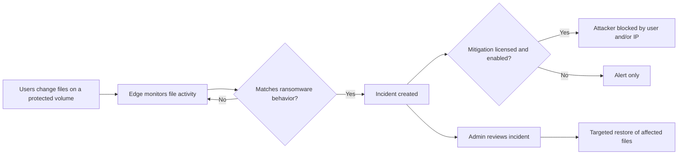

# Ransomware Protection on Nasuni Edge (NE): How It Works Today

## What it is

Ransomware Protection is a licensed feature that runs **on each Edge appliance**. It
watches file activity on protected volumes, flags behavior that looks like ransomware,
can block the attacker, and helps customers recover affected files.

## Licensing

There are two separate license entitlements:

| Entitlement                          | What it unlocks                                                      |
| ------------------------------------ | -------------------------------------------------------------------- |
| **Ransomware Detection**             | Find suspicious activity and create incidents                        |
| **Ransomware Mitigation & Reporting** | Block attackers automatically and view detailed incident reports    |

- Without Detection, customers can't turn the feature on.
- If either entitlement is removed later, the related settings are turned off
  automatically and any automatic blocks are lifted.

## Customer setup

- Customers turn the feature on **per volume**, from the NMC **Ransomware Protection**
  area or through the API.
- Only the volume's **owning Edge** can change its settings. Remote copies of the volume
  can't be configured.
- Customers choose a sensitivity level from 1 (Very Low) to 5 (Very High):
  - **Incident creation** defaults to **Medium (3)**.
  - **Automatic blocking** defaults to **High (4)**. It can't be more sensitive than
    incident creation.
- The block can target the **Username**, **IP Address**, or **Both**. Username is the
  default. Blocking requires an SMB (CIFS) volume, and username blocking also needs
  Active Directory.

## How it works

1. **Monitor:** The Edge watches file activity on protected volumes, such as reading,
   rewriting, renaming, and deleting files. Customers don't need to turn on auditing.
2. **Detect:** It looks for ransomware-like patterns over short time windows and matches
   filenames against known ransomware signatures. Nasuni refreshes those signatures
   about **every 4 hours**.
3. **Create an incident:** If activity goes over the chosen sensitivity level, the Edge
   records an incident with the affected volume, user, client, and files.
4. **Block:** If Mitigation is licensed and enabled, the Edge automatically blocks the
   attacker by username, IP address, or both.
5. **Recover:** Admins can review an incident timeline and run a **Targeted Restore**
   that rolls back only the affected files to an earlier point in time.

## Inside the detection engine (antiransom core package)

The detection logic ships as its own package (`nasuni-antiransom-python-lib`), which is
installed on every Edge. It handles **detection only**. Blocking, incident records, and
logging are handled by the Edge service that sits around it.

- **Watches behavior, not file contents:** It only looks at file actions (create, read,
  write, rename, delete). It never opens or scans file data.
- **Tracks each user on each device separately:** Activity is grouped by
  **volume + client device + user**, so one bad actor stands out from normal traffic.
- **Looks for typical ransomware patterns:**

  | Pattern | What it looks like in plain terms |
  | --- | --- |
  | Read, overwrite, rename | Encrypts a file in place, then changes its name |
  | Read, delete, create new | Writes an encrypted copy and deletes the original |
  | Either of the above plus a known ransomware extension | Same behavior, plus a filename that matches a known ransomware signature (strongest signal) |
  | Read, overwrite only | Tracked, but not used for alerting because normal editing looks the same |

- **Uses short, rolling time windows:** It counts suspicious files over roughly the last
  **5 minutes**. When a count crosses a threshold, the anomaly level (1 to 5) goes up.
- **Supports a safelist:** File patterns can be excluded to reduce false positives.
- **Includes an offline analyzer:** Engineering has a tool that replays an Edge's
  audit logs through the same logic. It shows what would have been flagged, which
  helps tune thresholds before changing them for customers.

## Ransomware Protection vs. Antivirus (ClamAV)

Both features appear under **Cyber Resilience** in NMC, but they're **separate
products** with separate engines, licenses, and settings. ClamAV is **not** part of
ransomware detection.

| | Ransomware Protection | Antivirus |
| --- | --- | --- |
| Engine | Nasuni behavior-based detection | Open-source ClamAV |
| What it looks at | Patterns of file activity | File contents (virus signatures) |
| When it runs | Continuously, as files change | On a schedule, plus optional check when a file is closed (SMB only) |
| What it finds | Ongoing ransomware attacks | Files that are already infected |
| What it does | Creates incidents, blocks the attacker, supports targeted restore | Lists violations; admins can ignore or delete infected files |
| Signature updates | Nasuni ransomware extension list, about every 4 hours | ClamAV virus database through Nasuni, within about 4 hours of a ClamAV update |
| License flag | `ransomware_detection`, `ransomware_mitigation_and_reporting` | `antivirus` |
| NMC pages | Detection & Mitigation, Incident Management, Blocked Sources | Antivirus Services, Antivirus Violations |

How they relate:

- **Shared foundations:** Both are enabled per volume, both are configured only on the
  volume's owning Edge, and both depend on Nasuni-hosted signature updates.
- **No runtime dependency:** Ransomware detection doesn't call ClamAV, and ClamAV doesn't
  feed ransomware incidents. Each can be turned on without the other.
- **Shared history:** On Edges older than 9.9, the ransomware on/off setting was stored
  with the antivirus settings. NMC still checks both places for older Edges. The
  antivirus API still accepts that old setting but ignores it.
- **Packaging:** ClamAV is installed on every Edge (`clamav`, `clamav-server`,
  `clamav-freshclam` 1.4.3 or later) with a Nasuni configuration. Nasuni turns off
  ClamAV's built-in updater and delivers virus definitions through its own service. The
  ClamAV engine runs only when at least one volume has antivirus turned on.
- **Edge file access:** The Edge tags ClamAV's file reads separately from user activity.
  Whether ransomware detection ignores those reads isn't visible in this repository.

## Related: Cyber Resilience data collection (opt-in)

The NMC **Account Status** page lets customers opt in to Cyber Resilience data
collection. A separate package (`nasuni-antiransom-data-collection`) collects SMB
activity data, pseudonymizes it with a key kept on the Edge, and uploads it to Nasuni.
This is separate from the detection and mitigation features above.

## Admin pages in NMC (Ransomware Protection)

- **Detection & Mitigation:** turn the feature on or off for each volume and set
  sensitivity and blocking choices.
- **Incident Management:** list incidents, open reports, start or cancel a targeted
  restore, and delete incidents.
- **Blocked Sources:** see blocked users and IP addresses, and unblock them.

## How it's kept healthy

- The Edge checks that the feature is running and that signature updates succeed. It
  raises an alert if either fails.
- Usage data, such as which volumes are protected and how many events are processed, is
  sent back for reporting.

## Scope notes for product management

- **Where it runs:** Each Edge protects only the volumes it owns. NMC and Portal are
  where customers manage it and see results.
- **Where the license applies:** Each Edge checks its own license.
- **Version support:** Edges on version 9.9 or later support incident creation and IP
  blocking. Username blocking requires version 10.1 or later.
